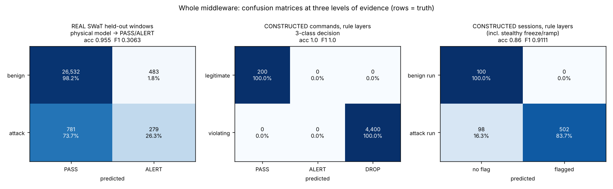
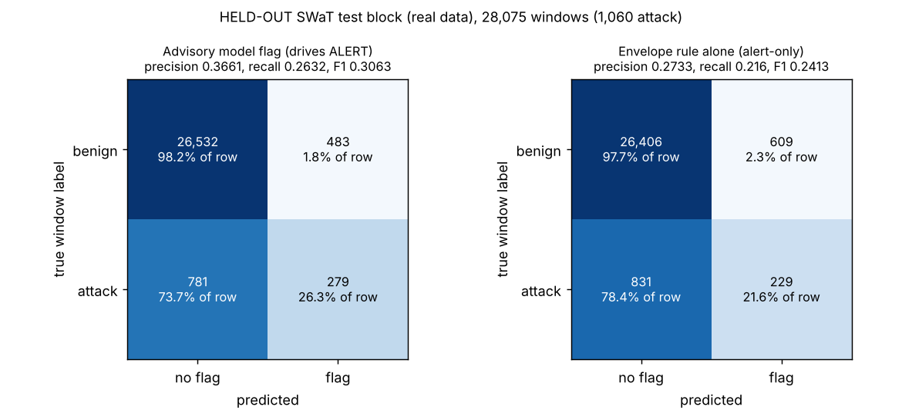
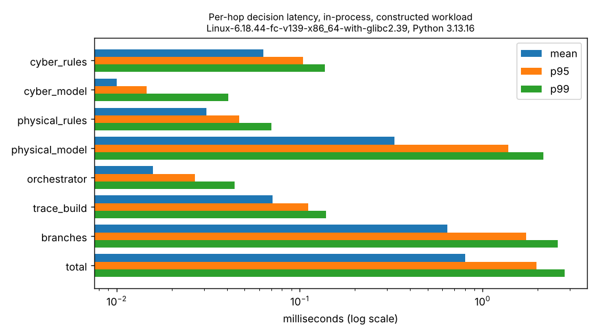

# IndustrialMind

**An inline cyber-physical security middleware for industrial control systems.**

IndustrialMind sits between a SCADA operator and a PLC (programmable logic controller) and inspects every Modbus/TCP command
before it reaches the plant. Each command is checked twice, independently:

* **Is the message legitimate?** The **Cyber Agent** checks who sent it, whether it is cryptographically signed, whether it is a
  replay and whether it arrives too fast.
* **Is the command physically safe?** The **Physical Agent** checks the value against the plant's measured safe ranges, how fast
  it is changing, and whether it would leave two related devices in a dangerous combination.

An **Orchestrator** combines both verdicts into one decision: **PASS** (forward it), **ALERT** (forward it but flag it), or
**DROP** (block it). A live web **dashboard** shows every decision, and a **Packet Tracer** shows, hop by hop, exactly why any
single command was passed or blocked.

The plant is a **digital twin** of a five-stage water-treatment process modelled on **SWaT** (Secure Water Treatment, iTrust,
Singapore University of Technology and Design), so the whole system can be demonstrated safely on laptops instead of real
industrial hardware. It runs on one computer for a rehearsal, or on four laptops for a real networked demo.

```
  SCADA (operator)          +---------------- MIDDLEWARE (this project) -----------------+        PLC digital twin
  signs every command --->  |  Cyber Agent    whitelist, function code, register,       |        5 stages x 4 points
  Modbus/TCP :5021          |                 rate limit, HMAC signature, replay         |        10 actuators
                            |  Physical Agent bounds, rate of change, cross-register     | --->   10 sensors
  ATTACKER (separate) --->  |                 + advisory ML model and invariant rules    |  only  Modbus/TCP :5020
  same port                 |  Orchestrator   rule-based fusion -> PASS / ALERT / DROP   |  PASS
                            +------------------------------------------------------------+  ALERT
                                               | every decision + its hop-by-hop trace
                                               v
                                      Dashboard  http://127.0.0.1:5050
```

---

## Contents

1. [How it works](#1-how-it-works)
2. [What you need](#2-what-you-need)
3. [Install (once per computer)](#3-install-once-per-computer)
4. [Option A: run everything on one computer](#4-option-a-run-everything-on-one-computer)
5. [Option B: the four-laptop demo, step by step](#5-option-b-the-four-laptop-demo-step-by-step)
6. [The attacks and what each one proves](#6-the-attacks-and-what-each-one-proves)
7. [Reading the dashboard](#7-reading-the-dashboard)
8. [Proving it on the wire with Wireshark](#8-proving-it-on-the-wire-with-wireshark)
9. [Results and how they were measured](#9-results-and-how-they-were-measured)
10. [Running the tests](#10-running-the-tests)
11. [Project structure](#11-project-structure)
12. [Configuration reference](#12-configuration-reference)
13. [Retraining the model (optional)](#13-retraining-the-model-optional)
14. [Troubleshooting](#14-troubleshooting)
15. [Known limitations](#15-known-limitations)
16. [Further documentation](#16-further-documentation)

---

## 1. How it works

### The five components

| Component | Where | What it does |
|---|---|---|
| **SCADA operator** | `scada/scada.py` | Simulates the control-room operator. Every 2 seconds it signs and sends one setpoint to the plant's actuators. After an attack it restores the plant to normal by itself. |
| **Middleware** | `middleware/` | The product. A Modbus/TCP server towards SCADA and a client towards the PLC. Runs the Cyber Agent, Physical Agent and Orchestrator on every command, forwards what is approved, blocks what is not. |
| **PLC digital twin** | `plc/` | A Modbus/TCP server around a physics simulation of the five treatment stages. It accepts writes only from the middleware's address, so even a write that bypasses the middleware is refused. |
| **Attacker** | `attacker/` | A separate client that sends malformed, unsigned, replayed, out-of-range or physically unsafe commands, to show what gets caught and why. |
| **Dashboard** | `dashboard/` | A read-only live web page: traffic counters, a network flow view, live plant telemetry, blocked sources and the Packet Tracer. It has no attack buttons by design. |

### The journey of one command

1. **SCADA signs the command.** It packs the register, value, a random one-time number (nonce) and a timestamp, and computes an
   **HMAC-SHA256** seal over them with a secret shared with the middleware (`core/hmac_auth.py`).
2. **The middleware receives it** on port 5021 and records the real network address it came from.
3. **The Cyber Agent checks it** (`middleware/cyber_agent.py`), stopping at the first failure:

   | # | Check | Blocks with |
   |---|---|---|
   | 1 | Source address is on the whitelist | `UNTRUSTED_SOURCE` |
   | 2 | Modbus function code is allowed | `INVALID_FUNCTION_CODE` |
   | 3 | Register is one of the 20 known registers | `INVALID_REGISTER` |
   | 4 | No more than 5 requests per second from this source | `RATE_LIMIT_EXCEEDED` |
   | 5 | HMAC seal is present, intact and less than 30 s old | `HMAC_MISSING` / `HMAC_INVALID` / `HMAC_EXPIRED` |
   | 6 | Nonce has never been seen before | `REPLAY_DETECTED` |

4. **The Physical Agent checks it** (`middleware/physical_agent.py`), at the same time:

   | Check | Blocks with |
   |---|---|
   | Only the 10 actuators accept commands (sensors are read-only) | `WRITE_TO_SENSOR_REGISTER` |
   | The value is inside the register's measured safe range | `OUT_OF_BOUNDS` |
   | The change fits the actuator's maximum speed | `RATE_OF_CHANGE_EXCEEDED` |
   | The command does not create a known-unsafe combination with another register (8 rules, e.g. pump running while its inlet valve is closed) | `CROSS_REGISTER_VIOLATION` |

   It also runs two **advisory** detectors on the live plant telemetry: a machine-learning model trained on real SWaT data
   (`models/physical_model_v2.py`) and optional physical-invariant rules learned from normal operation (`swat/invariants.py`).
   These can raise an **ALERT** but can never block.

5. **The Orchestrator decides** (`middleware/orchestrator.py`):

   | Cyber rules | Physical rules | Advisory detectors | Decision |
   |---|---|---|---|
   | fail | any | any | **DROP** |
   | pass | fail | any | **DROP** |
   | pass | pass | flag an anomaly | **ALERT** (forwarded, flagged) |
   | pass | pass | quiet | **PASS** |

6. **Outcome.** A PASS or ALERT command is written to the PLC on port 5020. A DROP is never sent; it is logged to
   `logs/blocked_attacks.jsonl`.
7. **The dashboard** receives the decision and its hop-by-hop trace within a fraction of a second.

**Design principle: learning never holds the gate.** Only the deterministic, auditable rules can block. The learned components can
only flag, so a false alarm can never stop a legitimate operator from running the plant.

### The plant: five SWaT-style stages

20 registers = 5 stages x 4 points. Names are real SWaT tags; ranges and nominal values are **measured** from SWaT normal data
(`docs/swat_bounds.json`). The stages are physically coupled, so a change upstream propagates downstream.

| Stage | Actuators (writable) | Sensors (read-only) |
|---|---|---|
| S1 Raw water | MV101 inlet valve, P101 pump | LIT101 tank level, FIT101 flow |
| S2 Chemical dosing | P203 HCl pump, P205 NaOCl pump | AIT202 pH, FIT201 flow |
| S3 Ultrafiltration | MV302 feed valve, P302 pump | LIT301 tank level, DPIT301 membrane pressure |
| S4 Dechlorination | P402 pump, UV401 UV lamp | LIT401 tank level, AIT402 ORP |
| S5 Reverse osmosis | P501 high-pressure pump, MV503 reject valve | PIT501 pressure, FIT501 permeate flow |

### Ports

| Port | Who listens | Who connects |
|---|---|---|
| **5020** | PLC | the middleware only |
| **5021** | Middleware | SCADA and the attacker |
| **5050** | Dashboard | a browser on the middleware computer |
| **5070** | Attack button panel | a browser on the attacker computer |

---

## 2. What you need

* **Python 3.13** on every computer. The middleware computer must use 3.13: the shipped model is a pickle tied to
  scikit-learn 1.9.1, and a Python 3.14 environment failed to load it in testing.
  * macOS: `brew install python@3.13`
  * Windows: `winget install Python.Python.3.13`, then open a **new** terminal. If typing `python` opens the Microsoft Store,
    turn off the two "python" entries under Settings > Apps > Advanced app settings > App execution aliases.
* **Git** (or a downloaded zip of this repository).
* **Optional:** Wireshark/tshark, for the packet-capture proof (section 8).
  * macOS: `brew install --cask wireshark`
  * Windows: the installer from wireshark.org; on the Npcap step tick **Npcap** and **Support loopback traffic capture**.
* **For the four-laptop demo:** four laptops on **one network that lets devices talk to each other**. A phone hotspot is the most
  reliable choice (see [why](#why-a-hotspot)).
* The SWaT dataset is **not** needed to run anything. It is only needed to retrain the model.

---

## 3. Install (once per computer)

Do this on every computer that will run part of the system.

### Step 1: get the code

```bash
git clone https://github.com/prrrrrpnch/IndustrialMinds.git
cd IndustrialMinds
```

Or download the repository as a zip and extract it. If you are updating an existing copy, extract the new zip **over** the old
folder so your `.venv` and `config/lab.env` are kept.

### Step 2: create a virtual environment and install the packages

**macOS / Linux**

```bash
python3.13 -m venv .venv
source .venv/bin/activate
python -m pip install -r requirements.txt
```

**Windows (PowerShell)**

```powershell
python -m venv .venv
Set-ExecutionPolicy -Scope Process Bypass
.\.venv\Scripts\Activate.ps1
python -m pip install -r requirements.txt
```

Use the folder name **`.venv`** exactly: the double-click launchers look for it. Always install with **`python -m pip`**, not
`pip`: some managed Windows laptops block `pip.exe` but allow `python`.

### Step 3: check the installation

```bash
python -m tests.test_environment
```

It must end with **`ALL PASS`** (it checks the pinned library versions and that the shipped model loads cleanly).

---

## 4. Option A: run everything on one computer

The fastest way to see the whole system working. All traffic stays on this one computer.

### Step 1: start it

**One click:** double-click `launchers/ONE_PC_BACKUP.command` (macOS) or `launchers\ONE_PC_BACKUP.bat` (Windows).
It starts the PLC, dashboard, middleware and SCADA, opens the dashboard in your browser and shows an attack menu.

**Or by hand,** in four terminals (activate `.venv` in each, start in this order):

```bash
python -m plc.plc                       # 1. the PLC digital twin, Modbus on :5020
python dashboard/app.py                 # 2. the dashboard, http://127.0.0.1:5050
python -m middleware.middleware_server  # 3. the middleware, Modbus on :5021
python -m scada.scada                   # 4. the operator: one signed write every 2 s
```

No secret needs setting on one computer: the first process that needs one creates `config/hmac_secret.key` and the others read it.

### Step 2: watch the normal traffic

Open `http://127.0.0.1:5050`. Within a few seconds the **SCADA -> PLC** table fills with green **PASS** rows and the telemetry
panel shows all 20 plant points.

**Wait about 2 minutes** before attacking. The physical model needs a full 120-second window of telemetry; until then it reports
`WARMING_UP`.

### Step 3: run an attack

In the one-click menu press a number (or **B** for the button panel). By hand, in a fifth terminal:

```bash
python -m attacker.attacker hmac-tamper
```

You should see a red **DROP** row with reason `HMAC_INVALID`, a red dot that stops inside the middleware on the **Live Network
Flow**, and in the **Packet Tracer** the `hmac` check in red with every later check marked `NOT_RUN`.

### Step 4: reset and stop

Click **Reset** on the dashboard to clear the counters, the flow view and the blocked-sources list for a fresh run. The old record
is set aside as `*.cleared-<timestamp>`, never deleted. Press **Q** in the one-click menu, or Ctrl-C each terminal, to stop.

---

## 5. Option B: the four-laptop demo, step by step

This shows a real networked attack: SCADA, the attacker and the PLC on separate machines, all traffic passing through the middleware.

### Step 1: assign the roles

| Laptop | Role | What runs on it |
|---|---|---|
| **Laptop 1** (Mac) | Middleware + dashboard + capture | middleware, dashboard, Wireshark/tshark |
| **Laptop 2** (Windows) | PLC | the PLC digital twin, tshark |
| **Laptop 3** (Mac) | SCADA operator | the operator simulator |
| **Laptop 4** (Windows) | Attacker | the attack button panel or command-line attacker |

Any operating system works for any role; this is the layout the launchers are written for. Install the project on all four
(section 3).

### Step 2: put all four laptops on one network

<a name="why-a-hotspot"></a>
**Use a phone hotspot.** Connect all four laptops to the same hotspot.

Why: many office, campus and guest Wi-Fi networks use **client isolation**, which stops devices on the same Wi-Fi from talking to
each other even though each can reach the internet. It looks exactly like a firewall block (`Host is down`, `No route to host`,
`timed out`) and no setting on the laptops can fix it. Phone hotspots do not isolate clients.

### Step 3: find each laptop's address

**macOS:** `ipconfig getifaddr en0`
**Windows:** `ipconfig`, then read the **IPv4 Address** under the Wi-Fi adapter.

Write all four down. Addresses can change whenever a laptop reconnects, so check them again before every demo.

### Step 4: create the same `config/lab.env` on all four laptops

Generate one shared secret, once, on any laptop:

```bash
python3 -c "import secrets; print(secrets.token_hex(24))"
```

Then create `config/lab.env` on **every** laptop with **identical** contents (replace each `<...>` with the real value):

```
MW_IP=<Laptop 1 address>
PLC_IP=<Laptop 2 address>
SCADA_IP=<Laptop 3 address>
ATTACKER_IP=<Laptop 4 address>
HMAC_SECRET=<the secret you generated>
DASHBOARD_BIND_HOST=127.0.0.1
DASHBOARD_TOKEN=
```

You can copy the template first: `cp config/lab.env.example config/lab.env` (Windows: `Copy-Item config\lab.env.example config\lab.env`).
This file is git-ignored on purpose: it holds your addresses and secret. Every launcher reads it, so you never export variables by hand.
The laptops do not have to share a subnet, only be able to reach each other; `SCADA_IP` and `ATTACKER_IP` also accept a CIDR block.

> **Check `SCADA_IP` and `ATTACKER_IP` carefully.** If they are swapped, the dashboard labels the operator as the attacker and its
> legitimate commands are treated as attacks.

### Step 5: open the PLC's firewall (Laptop 2 only)

In **PowerShell as Administrator** on Laptop 2:

```powershell
Set-NetConnectionProfile -NetworkCategory Private
New-NetFirewallRule -DisplayName "IM PLC 5020" -Direction Inbound -Action Allow -Protocol TCP -LocalPort 5020 -RemoteAddress <Laptop 1 address> -Profile Any
w32tm /resync
```

Also run `w32tm /resync` on Laptop 4. Signed commands older than 30 seconds are rejected, so every clock must agree; turn on
automatic time on all four laptops. If Laptop 1's address changes, delete and re-create this rule with the new address.

### Step 6: run the preflight check on each laptop

```bash
bash scripts/run.sh check middleware   # Laptop 1
bash scripts/run.sh check scada        # Laptop 3
```

```powershell
.\scripts\run.ps1 check plc            # Laptop 2
.\scripts\run.ps1 check attacker       # Laptop 4
```

Every line should be `OK`. The **HMAC secret fingerprint** printed on Laptops 1, 3 and 4 must be **identical**: it proves the
secrets match without revealing them.

### Step 7: start everything, in this order

| Order | Laptop | Double-click | Or run this |
|---|---|---|---|
| 1 | Laptop 2 | `launchers\laptop2_win_plc.bat` | `.\scripts\run.ps1 plc` |
| 2 | Laptop 1 | `launchers/laptop1_mac_middleware.command` | `bash scripts/run.sh dashboard`, then in a second terminal `bash scripts/run.sh middleware` |
| 3 | Laptop 3 | `launchers/laptop3_mac_scada.command` | `bash scripts/run.sh scada` |

What each launcher does:

* **Laptop 2** opens two windows: the PLC (it must print `PLC Modbus server running on 0.0.0.0:5020`) and a tshark capture of
  port 5020.
* **Laptop 1** opens the dashboard, the middleware and a tshark capture of port 5021, opens the dashboard in the browser, then
  waits and tells you when the PLC is reachable and the middleware has connected. On a first run it also creates `.venv`,
  installs the packages and asks for the `lab.env` values.
* **Laptop 3** waits until the middleware is reachable, then starts SCADA.

On macOS, if a `.command` file will not open, right-click it, choose **Open**, then **Open** again, or run
`chmod +x launchers/*.command` once. The first time the middleware starts, macOS asks whether Python may **accept incoming network
connections**: click **Allow**, or SCADA and the attacker cannot connect.

### Step 8: wait for the model, then confirm the healthy baseline

Wait **about 2 minutes** after the middleware starts. On Laptop 1's dashboard you should see:

* the header badge reading **ONLINE** (not `DEGRADED`),
* green **PASS** rows arriving every 2 seconds from SCADA,
* the **Live Network Flow** showing **SCADA** sending to the middleware and on to the PLC.

### Step 9: run the attacks (Laptop 4)

**Button panel:** double-click `launchers\laptop4_attack_panel.bat`. A page opens at `http://127.0.0.1:5070` with one button per
attack, the result each one should produce, **Run all**, **Stop**, and the attack's live output.

**Or the command line:**

```powershell
.\scripts\run.ps1 check attacker
.\scripts\run.ps1 attacker hmac-tamper
```

Run one attack at a time and watch Laptop 1's dashboard after each. Section 6 lists every attack and its expected result.

### Step 10: show the proof

For a blocked attack, point out three things side by side:

1. **Laptop 1's capture** shows the attack packet arriving (it really was sent).
2. **The dashboard** marks it **DROP** with a named reason, and the Packet Tracer shows which check failed.
3. **Laptop 2's capture** shows **nothing** for it: the attack never reached the PLC.

### Step 11: reset for the next run, then stop

* **Fresh demo:** click **Reset** on the dashboard. SCADA restores the plant to normal by itself about 15 s after an attack stops;
  to do it at once, run `bash scripts/run.sh scada --restore` on Laptop 3.
* **Stop:** close the windows in reverse order: attacker, SCADA, middleware and dashboard, PLC.

---

## 6. The attacks and what each one proves

| Attack | What it does | Expected result | What it proves |
|---|---|---|---|
| `hmac-missing` | sends a command with no signature | **DROP** `HMAC_MISSING` | unsigned commands are refused |
| `hmac-tamper` | signs a command, then changes the value | **DROP** `HMAC_INVALID` | any change in transit breaks the seal |
| `hmac-forged` | signs with a guessed key | **DROP** `HMAC_INVALID` | only holders of the real secret can sign |
| `replay` | re-sends a byte-identical signed command | first **PASS**, the repeat **DROP** `REPLAY_DETECTED` | a captured command cannot be reused |
| `flood` | a burst of signed commands above 5 per second | several **DROP** `RATE_LIMIT_EXCEEDED` | flooding is throttled per source |
| `impossible-command` | a signed, out-of-range value (P101 = 999) | **DROP** `OUT_OF_BOUNDS` | a valid signature does not make a value safe |
| `sensor-write` | a signed write to a read-only sensor | **DROP** `WRITE_TO_SENSOR_REGISTER` | sensors cannot be commanded |
| `cross-register` | slow, in-range steps that together create an unsafe state | the ramp is stopped, **DROP** `CROSS_REGISTER_VIOLATION` | multi-step "low and slow" attacks are caught |
| `random --type ramp` | a randomised slow drift (new parameters each run, seed printed) | depends on the seed: fast steps **DROP**, slow in-range steps may pass with an **ALERT** | the limits of rule-based detection, honestly shown |
| `false-injection` | a legitimate command, then a write **directly to the PLC**, bypassing the middleware | four laptops: the direct write is **refused by the PLC** itself | defence in depth: the PLC only accepts writes from the middleware's address |

**`false-injection` on one computer.** Every process there shares the address 127.0.0.1, the same as the middleware, so the PLC
cannot tell the attacker apart and accepts the direct write. The plant then drifts and later commands carry an **ALERT** from the
physical model, which shows that an attack bypassing the middleware is only visible through the physics. The PLC's refusal can only be
shown with separate machines.

**Two threat models.** `flood`, `replay`, `impossible-command`, `cross-register` and `random` model a **compromised workstation that
holds the secret** (an insider), so the signature passes and the later layers must stop it. The `hmac-*` attacks model an
**outsider without the secret**.

**Two attack modes on four laptops.** By default the attacker's address is on the whitelist (`ATTACKER_IP` in `lab.env`), so its
commands get past the first check and the later layers stop them: everything in the table above. To show an **outside stranger**
instead, remove `ATTACKER_IP` from Laptop 1's `lab.env` and restart the middleware: every attacker frame then dies at the first
check with `UNTRUSTED_SOURCE`.

---

## 7. Reading the dashboard

Open `http://127.0.0.1:5050` on Laptop 1.

| Panel | What it shows |
|---|---|
| **Header badge** | `ONLINE`, or `DEGRADED` with the reason (for example, the PLC is unreachable) |
| **Total / Pass / Drop** | running counters since the last Reset |
| **Live Network Flow** | each command as a dot from the host that sent it (SCADA or the attacker) to the middleware and, if approved, on to the PLC. A dropped command stops inside the middleware. Green = PASS, amber = ALERT, red = DROP |
| **SCADA -> PLC / PLC -> SCADA** | every command with its verdict, reason and latency, and the PLC's confirmations |
| **Live PLC Telemetry** | the five stages with live tank levels, gauges and every actuator and sensor value |
| **Blocked IPs / Blocked Sources** | every blocked command, grouped by source, filterable by attack type |
| **Investigations** | an optional, read-only plain-English write-up of serious incidents (see below) |
| **Packet Tracer** | pick any command to see every check it went through, with the real values computed, each `PASS`, `FAIL` or `NOT_RUN` |

**Investigations (optional).** With `IM_INVESTIGATOR=1` and an Anthropic API key, an LLM agent (`middleware/investigator.py`)
writes up high-severity incidents **after** the decision is already made. It reads the evidence through read-only tools and must
answer in a fixed schema. It cannot change a verdict, act on the plant or block anything; without a key, a deterministic engine
writes the same kind of finding.

---

## 8. Proving it on the wire with Wireshark

The dashboard is the system describing itself. A packet capture is independent proof.

* **Laptop 1** captures port 5021 (everything arriving at the middleware).
* **Laptop 2** captures port 5020 (everything that actually reached the PLC).

Wireshark decodes Modbus only on port 502 by default. Set the Modbus/TCP **port preference** (not *Decode As*):

```bash
tshark -i en0 -f "tcp port 5021" -o mbtcp.tcp.port:5021 -Y mbtcp                                   # Laptop 1 (macOS)
```

```powershell
& "C:\Program Files\Wireshark\tshark.exe" -i <adapter number> -f "tcp port 5020" -o mbtcp.tcp.port:5020 -Y mbtcp   # Laptop 2
```

Find the adapter number with `tshark -D`. To capture both legs in one capture, give **one** range, `-o mbtcp.tcp.port:5020,5021`
(passing the flag twice makes the second replace the first).

Every signed command carries a nonce on the wire, and the Packet Tracer's Arrival hop shows the same nonce, so any packet can be
matched to its dashboard row. `python -m tools.wire_correlate --mw mw.tsv --plc plc.tsv` does the matching automatically and checks
that every dropped command appears on the middleware leg but never on the PLC leg. Full guide: `docs/wireshark_setup.md`.

---

## 9. Results and how they were measured

Three kinds of evidence are reported, and they are **never blended into one number**, because they answer different questions:

1. **Rule conformance** (constructed scenarios): does each rule do exactly what it is specified to do? A pass/fail correctness check,
   not a detection rate.
2. **Digital-twin detection** (live): real attacks and legitimate traffic sent over Modbus/TCP to the running system, outcomes read
   back and scored with confusion-matrix metrics, next to a never-alarm baseline.
3. **Held-out real SWaT data:** the only result comparable to published research. Splits are **chronological** (SWaT sensors drift
   by day, so random splits would leak), the decision threshold is fixed on validation data **before** the test block is scored, and
   the test block is never trained or tuned on.

One command regenerates everything below and the full report (`docs/reports/benchmark_report.md`); a test fails if the numbers here
drift from the data:

    python -m benchmark.run_all                                # latency, rule checks, twin (reuses the stored SWaT section)
    python -m benchmark.run_all --data-dir "<SWaT archive>"    # also re-measures the held-out SWaT test block

<!-- BENCHMARK:START (generated by python -m benchmark.run_all; do not edit by hand) -->

_Regenerate: `python -m benchmark.run_all [--data-dir <SWaT archive>]`. Full tables: `docs/reports/benchmark_report.md`. These numbers: Linux-6.18.44-fc-v139-x86_64-with-glibc2.39, Python 3.13.16, commit `371ce53`._

* **Decision latency** (real pipeline, in-process, 3000 commands x 3): mean **0.801 ms**, p95 **1.972 ms**, p99 **2.797 ms** per command (not network latency).
* **Held-out SWaT test block** (real data, physical model only, advisory): ROC-AUC **0.84**, precision 0.46, recall 0.51, F1 0.49, 1.173 false-alarm episodes per hour, 8/10 attack segments detected.
* **Rule-based checks** (constructed scenarios, not SWaT): 4400/4400 violating scenarios dropped with the expected reason, legitimate false-positive rate 0.0%. Deterministic rules: a regression check, not a detection claim.
* **Twin** (synthetic plant, not SWaT): 0.0 model alarm episodes per hour on the healthy twin.


**Whole middleware at a glance** (details and the 3-class matrix in the report):

| What is scored | Evidence | n | Accuracy | Precision | Recall | F1 | False-positive rate | TN / FP / FN / TP |
|---|---|---|---|---|---|---|---|---|
| Physical model flag -> ALERT | REAL SWaT held-out windows | 28080 | 0.959 | 0.461 | 0.513 | 0.485 | 0.024 | 26,382 / 637 / 517 / 544 |
| Rule layers, all violations vs legitimate commands | constructed commands | 4600 | 1.000 | 1.000 | 1.000 | 1.000 | 0.000 | 200 / 0 / 0 / 4,400 |
|   cyber layer only | constructed commands | 2000 | 1.000 | 1.000 | 1.000 | 1.000 | 0.000 | 200 / 0 / 0 / 1,800 |
|   physical layer only | constructed commands | 2800 | 1.000 | 1.000 | 1.000 | 1.000 | 0.000 | 200 / 0 / 0 / 2,600 |
| Rule layers, attack sessions vs benign sessions (incl. stealthy freeze/ramp) | constructed sessions | 700 | 0.860 | 1.000 | 0.837 | 0.911 | 0.000 | 100 / 0 / 98 / 502 |







<!-- BENCHMARK:END -->

**About the SWaT score.** Most published SWaT results use *point-adjust* scoring, where one flagged second credits a whole attack.
Under that convention the **same alarms** score F1 **0.685** instead of the strict per-window **0.485** above; only the counting
differs (`docs/reports/swat_scoring_comparison.md`).

**More evidence:**

* `python -m benchmark.evidence_pack`: a live attack campaign against the running stack, with per-attack results
  (`docs/reports/evidence_pack.md`).
* `python -m benchmark.assurance`: robustness (malformed input, degraded telemetry, noise, concurrency), consistency,
  explainability, drift and fail-safe behaviour (`docs/reports/assurance_report.md`).
* `python -m tools.sim_four_laptops`: all four roles on one machine with real packet captures, cross-checked against the tracer
  and logs (`docs/reports/system_flow_verification.md`).

---

## 10. Running the tests

The tests are plain Python scripts; each ends with `ALL PASS` or reports what failed. From the project root, with `.venv` active:

```bash
python -m tests.run_all                  # every test, saves a dated record to benchmarks/test_results.json
python -m tests.test_cyber_agent         # or any single script
```

| Script | Covers |
|---|---|
| `test_cyber_agent`, `test_physical_agent`, `test_orchestrator` | every rule and the fusion table |
| `test_pipeline`, `test_trace` | the concurrent pipeline, and that the Packet Tracer matches the real decision |
| `test_audit_fixes`, `test_sprint_fixes`, `test_quarter_fixes` | every defect found in the adversarial audit, pinned so it cannot return |
| `test_response_layer`, `test_dashboard_auth`, `test_per_device_keys` | policy, quarantine, incidents, dashboard token, per-device keys |
| `test_bounds_alignment`, `test_twin_propagation` | the twin against the measured SWaT bounds; stage-to-stage propagation |
| `test_invariants`, `test_physical_v2_live`, `test_physical_explain` | the invariant engine, the live model, its explanations |
| `test_attacker_randomization`, `test_attack_panel` | randomised attacks really vary; the attack button panel |
| `test_benchmark`, `test_environment` | benchmarks are reproducible; library pins and model loading |

Two scripts need extra setup and are skipped by default: `python -m tests.run_all --with-plc` (needs a running PLC) and
`--with-stress` (a load test).

---

## 11. Project structure

```
IndustrialMinds/
├── plc/            PLC digital twin: plc.py (Modbus server, writer allow-list), twin.py (physics)
├── scada/          the operator simulator (signs commands, auto-recovers the plant)
├── middleware/     the product
│   ├── middleware_server.py   Modbus transport and entry point
│   ├── ingest.py              decision path: queue, pipeline, logging
│   ├── forwarding.py          PLC write path: bounded queue, single worker
│   ├── polling.py             PLC read path: telemetry, backoff
│   ├── runtime.py             shared config and state
│   ├── cyber_agent.py         the cyber rules
│   ├── physical_agent.py      the physical rules
│   ├── orchestrator.py        the four-branch fusion
│   ├── trace.py               builds the Packet Tracer record
│   ├── policy.py, quarantine.py, incidents.py   optional response layer
│   └── investigator.py        optional LLM investigation (out of band)
├── pipeline/       runs the cyber and physical branches concurrently
├── models/         the physical ML model, explanations, shipped weights (models/weights/)
├── swat/           SWaT loader and the feature code shared by training and live scoring
├── core/           shared contracts: registers (interfaces.py), HMAC, network config, logs, forensics
├── attacker/       attacks (attacker.py), randomised plans (scenarios.py), button panel (control_panel.py)
├── dashboard/      Flask app, HTML, JavaScript, CSS
├── launchers/      double-click start files per laptop, and the one-computer backup
├── scripts/        run.sh / run.ps1: one command per role, reading config/lab.env
├── config/         lab.env.example (template), example policy, fitted invariants
├── benchmark/      benchmark, evidence and assurance harnesses
├── benchmarks/     generated benchmark results (JSON)
├── tools/          preflight check, wire correlation, invariant fitting, investigator CLI
├── tests/          one test script per area
├── research/       rejected experiments, kept as documented negative results
├── docs/           documentation and generated reports (see section 16)
└── final-results/  the adversarial audit and the evidence for each fix
```

---

## 12. Configuration reference

On one computer everything defaults to loopback and nothing needs setting. For several computers, put the addresses and secret in
`config/lab.env` (section 5, step 4); the launchers translate it into the variables below. All defaults live in `core/netconfig.py`.

| Variable | Meaning (default) |
|---|---|
| `IM_PLC_HOST` / `IM_PLC_PORT` | where the middleware and attacker reach the PLC (loopback:5020) |
| `IM_MIDDLEWARE_HOST` / `IM_MIDDLEWARE_PORT` | where SCADA and the attacker reach the middleware (loopback:5021) |
| `IM_TRUSTED_SOURCES` | the Cyber Agent's source whitelist, IPs and CIDRs (loopback) |
| `IM_PLC_ALLOWED_WRITERS` | who the PLC accepts writes from (the middleware's address; `any` disables the check) |
| `IM_HMAC_SECRET` | shared secret, 32+ characters (otherwise `config/hmac_secret.key`, auto-generated) |
| `IM_HMAC_MAX_SKEW_SECONDS` | how old a signed command may be (30) |
| `IM_DASHBOARD_BIND_HOST` / `IM_DASHBOARD_TOKEN` | dashboard bind address (loopback); a token is required before binding to a network address |
| `IM_LOG_DIR` | where `blocked_attacks.jsonl` and the forensic record are written (`logs`) |
| `IM_INVARIANTS` | turn on the physical-invariant rules (off) |
| `IM_PHYSICAL_SENSITIVITY` / `IM_PHYSICAL_THRESHOLD` | model operating point: `balanced` (default) or `sensitive`, or a raw probability |
| `IM_QUARANTINE` | auto-quarantine of repeatedly misbehaving sources (`auto` from the launcher) |
| `IM_INVESTIGATOR` | turn on the LLM investigation layer (off; needs an API key) |
| `IM_TWIN_NOISE`, `IM_TWIN_TIME_SCALE` | twin sensor noise (on), speed-up factor (1) |

Every entry point also accepts command-line flags that override these (for example `python -m plc.plc --host --port`).

---

## 13. Retraining the model (optional)

The demo needs **no training**: the live model ships in `models/weights/physical_model_v2.joblib`. Retraining needs the licensed
SWaT archive on the machine that runs it, and always writes a **candidate** to `models/candidates/`, never over the live weights:

```bash
python -m models.train_physical_v2 --data-dir "<SWaT archive>" --candidate   # the live model's trainer (30-90 minutes)
python -m benchmark.run_all --data-dir "<SWaT archive>"                      # re-measure on the held-out test block
```

A candidate replaces the live model only after its report is reviewed (`models/package_physical_v2.py`). The data is never
committed; everything in `docs/reports/` is aggregate statistics only. The cyber branch has **no learned model by design**: a
SWaT-trained candidate measured ROC-AUC 0.63 and was not promoted, and a learned fusion model performed worse than the physical
model alone. Both are kept in `research/` as documented negative results. Details: `docs/MODELS_RATIONALE.md`.

---

## 14. Troubleshooting

| Symptom | Cause and fix |
|---|---|
| Middleware says `Host is down`, `No route to host` or `timed out` for the PLC | The laptops cannot reach each other. Check both are on the same network and the addresses in `lab.env` are current. If `ping <PLC address>` fails from Laptop 1, the Wi-Fi isolates clients: move all four laptops to a **phone hotspot** |
| `Connection refused` to the PLC | The network works but the PLC is not running. Start it on Laptop 2 and keep its window open |
| PLC reachable by `ping` but port 5020 times out | The firewall rule on Laptop 2 is missing or names an old Laptop 1 address. Re-create it (section 5, step 5) |
| Attacker check: `can reach the middleware ... timed out` | The middleware is not running on Laptop 1, or Laptop 1's address changed |
| Every command is `DROP` `UNTRUSTED_SOURCE` | The sender's address is not in `lab.env` on Laptop 1. Fix it and restart the middleware |
| Every command is `DROP` `HMAC_INVALID` | The secret differs between laptops. Compare the fingerprints from `run.sh check` / `run.ps1 check` |
| Every command is `DROP` `HMAC_EXPIRED` | A clock is more than 30 s off. Run `w32tm /resync` on Windows; turn on automatic time |
| SCADA shows as **Attacker laptop** on the flow view | `SCADA_IP` and `ATTACKER_IP` are swapped in Laptop 1's `lab.env`. Fix, restart the middleware and dashboard, click Reset |
| SCADA connects to `127.0.0.1` / "HMAC_SECRET is not set" | `config/lab.env` is missing on that laptop. Create it (section 5, step 4) |
| `No .venv found` from a launcher | The project was extracted to a new folder. Extract over the old folder, or run section 3 in the new one |
| `pip.exe ... blocked by an Application Control policy` | Use `python -m pip install -r requirements.txt` |
| `Unable to copy ... venvlauncher.exe` when creating `.venv` | Use `python -m venv --copies .venv` |
| `numpy ... compiled for cp312 ... incompatible with cpython-313` | The `.venv` mixes Python versions. Delete it and recreate it with `py -3.13 -m venv .venv` |
| `test_environment` fails loading the model (`ImportError`) | Use Python 3.13 and scikit-learn 1.9.1 (`python -m pip install scikit-learn==1.9.1`) |
| Physical model stays `WARMING_UP` | Normal for the first 2 minutes: it needs 120 s of telemetry |
| Constant `ALERT` on a healthy plant | The PLC runs with `IM_TWIN_NOISE=0`; a perfectly flat plant looks abnormal to the model. Remove the variable |
| Wireshark shows no Modbus | Set the Modbus/TCP port preference to 5020/5021 (do not use *Decode As*) |
| Chrome will not open the attack panel | Use the default port 5070; browsers block 5060 and 5061 |
| `Address already in use` | A previous copy is still running on 5020, 5021, 5050 or 5070. Close it |

---

## 15. Known limitations

Stated plainly; none of these is hidden elsewhere.

1. **One real dataset.** Every learned result and measured bound comes from SWaT (one testbed, a few days). Behaviour on another
   plant is unknown.
2. **SWaT has no network traffic.** The cyber rules cannot be evaluated on real attacks; they are tested with constructed
   scenarios, and 100 % there is a correctness check, not a detection rate.
3. **The physical model is moderate and advisory.** On held-out SWaT it ranks attacks well (ROC-AUC 0.84) but flags about half of
   the attack windows (F1 0.49) and raises about 1.2 false-alarm episodes per hour. Slow, in-range attacks often stay below its
   threshold. It never blocks.
4. **The test block is not pristine.** A disclosed protocol revision after the first training run means the test block informed the
   final protocol (both runs are in `docs/reports/`).
5. **The twin is a demonstration plant,** not a SWaT replica. MV503 has no SWaT counterpart; the physics is simplified.
6. **A shared secret lets an insider sign anything.** That is why the rate limit, replay check and Physical Agent sit behind the
   signature. Per-device keys are built and tested (`IM_HMAC_KEYS`) but off by default.
7. **No encryption.** Commands are authenticated and integrity-protected, not confidential. Intended for a private demo network.
8. **Network requirements.** The four-laptop demo has been run on real hardware (2 Macs, 2 Windows laptops); it needs a network
   without client isolation.
9. **Coarse wire format.** Values are sent as value x 10 (0.1 resolution), so pH and permeate flow are coarse.
10. **Pinned library.** The shipped model loads cleanly only with scikit-learn 1.9.1 (enforced by a test).

---

## 16. Further documentation

| Document | Contents |
|---|---|
| `docs/PROJECT_DETAILS.md` | the complete technical description of every component, algorithm, parameter and result |
| `docs/MODELS_RATIONALE.md` | why the learned components are shaped as they are, and what was rejected |
| `docs/MODEL_CARD.md` | the live physical model's card: operating point, measured cost, limits |
| `docs/INVARIANTS.md` | the physical-invariant rules: how they are learned and validated |
| `docs/demo_workflow.md` | roles, start order, aftermath of an attack and recovery |
| `docs/topology.md` | the multi-laptop layout, firewall rules and preflight in depth |
| `docs/wireshark_setup.md` | capture filters, field names, the side-by-side demo |
| `docs/register_map.md` | the full register table and wire format |
| `docs/reports/` | training, benchmark, assurance and verification reports (aggregate only) |
| `final-results/AUDIT.md` | the adversarial audit and the evidence for each fix |
| `GETTING_STARTED.md` | advanced setup: tuning the model, hardening options, training model v3 |
| `launchers/START_HERE.txt` | the double-click launchers on one page |
| `CHECKLIST_VERIFICATION.txt` | every verified claim and what is still unmeasured, generated by `python -m tools.verification_record` |
