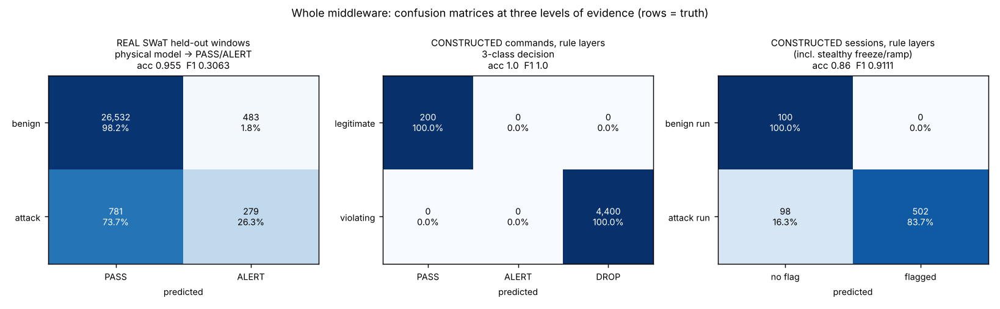
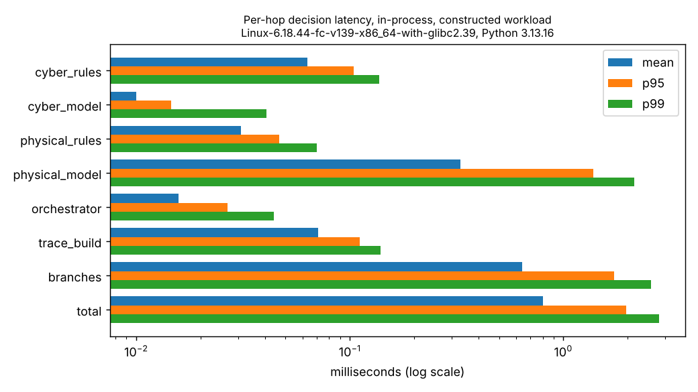
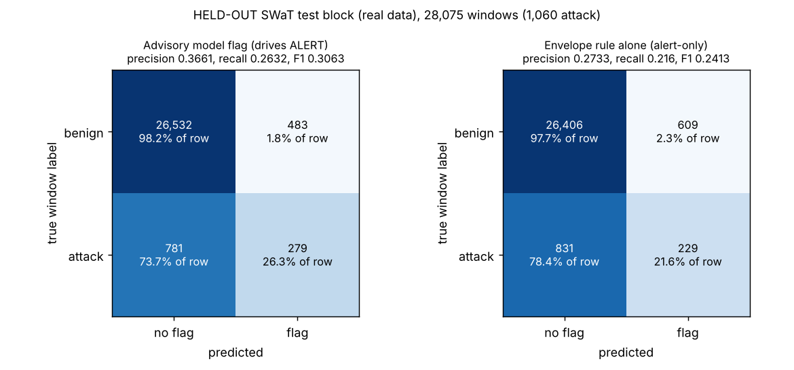
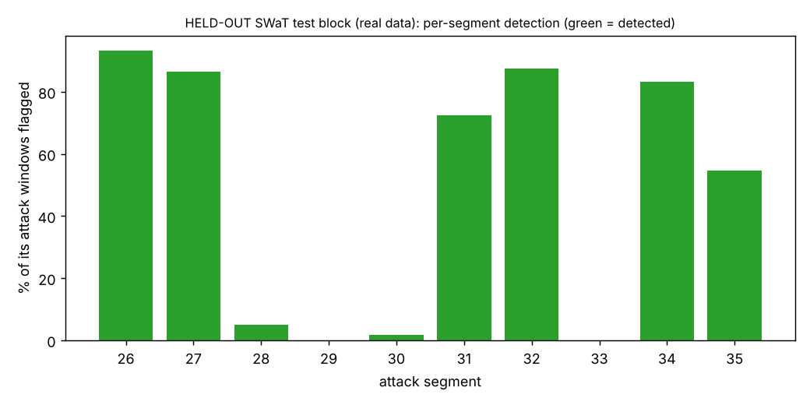
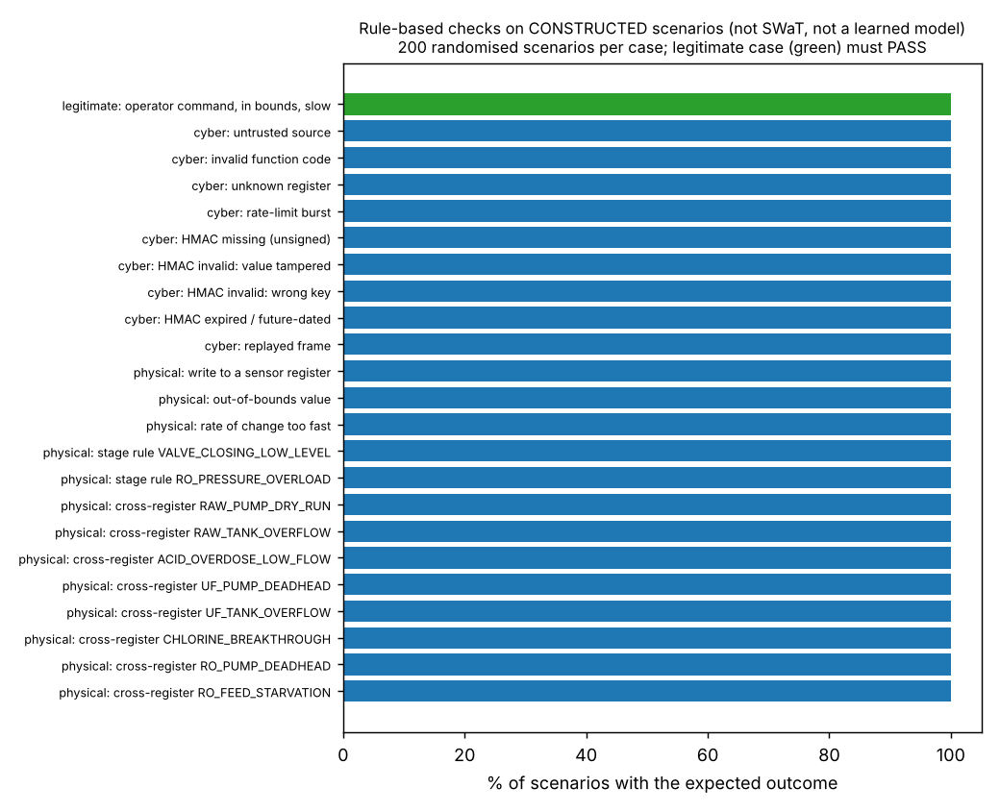
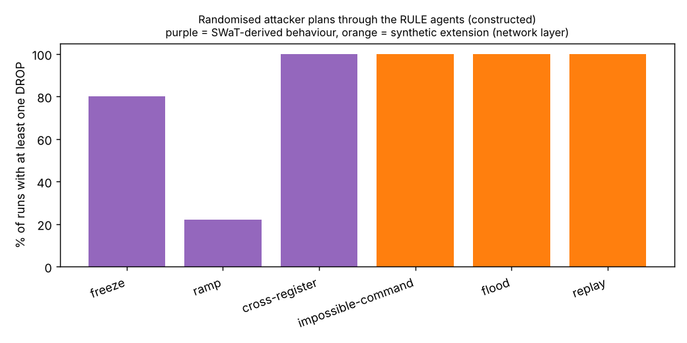
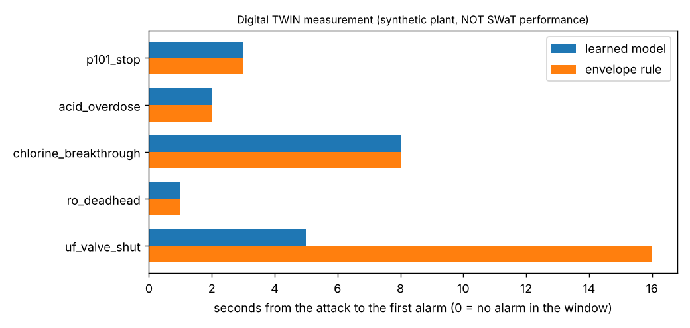

# IndustrialMind benchmark report

_Generated 2026-10-20 16:40:57 UTC by `python -m benchmark.run_all` at commit `371ce53`. Every number below comes from `benchmarks/latest.json`; nothing is typed by hand._

Four sections, deliberately separate because they answer different questions and have different evidential weight:

| Section | Data | What it supports |
|---|---|---|
| 1. Latency | constructed workload, real code | speed of the decision pipeline |
| 2. Held-out SWaT | REAL data (test block) | the only real-data detection performance (physical side) |
| 3. Rule-based checks | constructed scenarios | each deterministic rule fires on what it was written for |
| 4. Twin measurements | synthetic plant | demo behaviour of the model on the digital twin |

## Whole middleware at a glance

| What is scored | Evidence | n | Accuracy | Precision | Recall | F1 | False-positive rate | TN / FP / FN / TP |
|---|---|---|---|---|---|---|---|---|
| Physical model flag -> ALERT | REAL SWaT held-out windows | 28080 | 0.959 | 0.461 | 0.513 | 0.485 | 0.024 | 26,382 / 637 / 517 / 544 |
| Rule layers, all violations vs legitimate commands | constructed commands | 4600 | 1.000 | 1.000 | 1.000 | 1.000 | 0.000 | 200 / 0 / 0 / 4,400 |
|   cyber layer only | constructed commands | 2000 | 1.000 | 1.000 | 1.000 | 1.000 | 0.000 | 200 / 0 / 0 / 1,800 |
|   physical layer only | constructed commands | 2800 | 1.000 | 1.000 | 1.000 | 1.000 | 0.000 | 200 / 0 / 0 / 2,600 |
| Rule layers, attack sessions vs benign sessions (incl. stealthy freeze/ramp) | constructed sessions | 700 | 0.860 | 1.000 | 0.837 | 0.911 | 0.000 | 100 / 0 / 98 / 502 |

Three-class decision matrix of the rule layers on constructed commands (rows = truth, columns = decision):

| truth | PASS | ALERT | DROP |
|---|---|---|---|
| truth_PASS (legitimate) | 200 | 0 | 0 |
| truth_DROP (violating) | 0 | 0 | 4,400 |

**How to read this.** There is no single accuracy for the whole middleware, because the evidence has different strengths and must not be pooled. Only the first row is real-data performance (physical model, advisory, SWaT held-out). The other rows test the deterministic RULE layers on scenarios *we built*: perfect scores there mean each rule fires on what it was written for (a regression check), and the session-level row shows the honest gap, the stealthy in-bounds attacks the rules do not stop. Accuracy alone is misleading on imbalanced data: judge by recall, precision and the false-positive rate.

## 1. Latency (per hop)

**What this is.** In-process decision latency of the real pipeline on a constructed workload (no sockets). 3000 commands x 3 repeats after 300 warm-up, seed 7; 70% legitimate, 30% attacks (tamper, unsigned, replay, out-of-bounds, untrusted source, cross-register).

Measured on Linux-6.18.44-fc-v139-x86_64-with-glibc2.39, Python 3.13.16, 4 CPUs, scikit-learn 1.9.1, commit `371ce53`. Latency depends on the machine: re-run `python -m benchmark.run_all` on yours.

| Hop | mean (ms) | p50 (ms) | p95 (ms) | p99 (ms) |
|---|---|---|---|---|
| Cyber Agent rules | 0.0635 | 0.0588 | 0.1043 | 0.1377 |
| Cyber model (NO_MODEL stub) | 0.0100 | 0.0087 | 0.0146 | 0.0406 |
| Physical Agent rules | 0.0310 | 0.0283 | 0.0466 | 0.0698 |
| Physical model (assess; includes window refresh) | 0.3300 | 0.0089 | 1.3773 | 2.1452 |
| Orchestrator fusion | 0.0158 | 0.0138 | 0.0268 | 0.0440 |
| Packet-trace build | 0.0711 | 0.0668 | 0.1111 | 0.1394 |
| Both branches (concurrent, wall time) | 0.6397 | 0.3419 | 1.7245 | 2.5686 |
| TOTAL per command | 0.8011 | 0.5012 | 1.9723 | 2.7970 |

Spread of the total across repeats: mean 0.7835-0.8132 ms, p95 1.8759-2.0592 ms. The two branches overlap, so hops do not sum to the total.

## 2. Held-out SWaT (real data)

**PROMOTED physical model (PhysicalModelV2) on the HELD-OUT SWaT test block (real data, aggregate only).** test block was used for exactly two refits in the v2 experiment (baseline and selected) and was also seen by the shipped model's revised protocol: held-out, not a pristine blind test. Windows need a 120 s history, so the window set differs slightly from the v1 record.

_Source: reused from benchmarks/swat_accuracy.json (measured earlier on the machine that holds the archive)_

Test block: 28,080 windows (stride 5 s): 1,061 attack, 27,019 benign (37.53 benign hours). Operating point: classifier threshold 0.788, variant `v2`.

| Decision rule | precision | recall | F1 | false-positive rate | accuracy | balanced accuracy | alarm episodes / benign hour |
|---|---|---|---|---|---|---|---|
| Advisory model flag (drives ALERT) | 0.461 | 0.513 | 0.485 | 0.024 | 0.959 | 0.745 | 1.173 |

Plain accuracy is shown but is **not the headline**: attacks are only 3.8% of windows, so a system that never flags anything would score **0.962** accuracy (balanced accuracy 0.5). Judge the model by recall, precision, false alarms per hour and AUC.

Confusion counts (windows; rows = true label, columns = prediction):

| Decision rule | benign, no flag (TN) | benign, flagged (FP) | attack, no flag (FN) | attack, flagged (TP) |
|---|---|---|---|---|
| Advisory model flag | 26,382 | 637 | 517 | 544 |

ROC-AUC (attack probability) **0.836**, average precision 0.363.
Attack segments detected: **8/10**; median detection latency 57.5 s (first flagged attack window after the segment starts).

| Segment | attack windows | duration (s) | flagged windows | detected | latency (s) |
|---|---|---|---|---|---|
| 26 | 120 | 600 | 112 | yes | 40 |
| 27 | 89 | 445 | 77 | yes | 55 |
| 28 | 20 | 100 | 1 | yes | 60 |
| 29 | 96 | 480 | 0 | no | n/a |
| 30 | 108 | 540 | 2 | yes | 75 |
| 31 | 94 | 470 | 68 | yes | 130 |
| 32 | 56 | 280 | 49 | yes | 35 |
| 33 | 80 | 400 | 0 | no | n/a |
| 34 | 60 | 300 | 50 | yes | 50 |
| 35 | 338 | 1690 | 185 | yes | 85 |

## 3. Rule-based checks and constructed scenarios (NOT SWaT, NOT a learned model)

**RULE-BASED checks on CONSTRUCTED scenarios (deterministic rules; NOT SWaT, NOT a learned model).** 200 randomised scenarios per case, seed 7, virtual clock. A scenario counts as detected only when the real pipeline returns DROP **with the expected reason**. The rules are deterministic, so 100 % is expected: this is a regression check that each rule fires on what it was written for, not evidence of performance against an unknown attacker.

| Layer | Case | Expected | As expected |
|---|---|---|---|
| legitimate | operator command, in bounds, slow | `PASS` | 200/200 (100.0%) |
| cyber | untrusted source | `UNTRUSTED_SOURCE` | 200/200 (100.0%) |
| cyber | invalid function code | `INVALID_FUNCTION_CODE` | 200/200 (100.0%) |
| cyber | unknown register | `INVALID_REGISTER` | 200/200 (100.0%) |
| cyber | rate-limit burst | `RATE_LIMIT_EXCEEDED` | 200/200 (100.0%) |
| cyber | HMAC missing (unsigned) | `HMAC_MISSING` | 200/200 (100.0%) |
| cyber | HMAC invalid: value tampered | `HMAC_INVALID` | 200/200 (100.0%) |
| cyber | HMAC invalid: wrong key | `HMAC_INVALID` | 200/200 (100.0%) |
| cyber | HMAC expired / future-dated | `HMAC_EXPIRED` | 200/200 (100.0%) |
| cyber | replayed frame | `REPLAY_DETECTED` | 200/200 (100.0%) |
| physical | write to a sensor register | `WRITE_TO_SENSOR_REGISTER` | 200/200 (100.0%) |
| physical | out-of-bounds value | `OUT_OF_BOUNDS` | 200/200 (100.0%) |
| physical | rate of change too fast | `RATE_OF_CHANGE_EXCEEDED` | 200/200 (100.0%) |
| physical | stage rule VALVE_CLOSING_LOW_LEVEL | `CROSS_REGISTER_VIOLATION:VALVE_CLOSING_LOW_LEVEL` | 200/200 (100.0%) |
| physical | stage rule RO_PRESSURE_OVERLOAD | `CROSS_REGISTER_VIOLATION:RO_PRESSURE_OVERLOAD` | 200/200 (100.0%) |
| physical | cross-register RAW_PUMP_DRY_RUN | `CROSS_REGISTER_VIOLATION:RAW_PUMP_DRY_RUN` | 200/200 (100.0%) |
| physical | cross-register RAW_TANK_OVERFLOW | `CROSS_REGISTER_VIOLATION:RAW_TANK_OVERFLOW` | 200/200 (100.0%) |
| physical | cross-register ACID_OVERDOSE_LOW_FLOW | `CROSS_REGISTER_VIOLATION:ACID_OVERDOSE_LOW_FLOW` | 200/200 (100.0%) |
| physical | cross-register UF_PUMP_DEADHEAD | `CROSS_REGISTER_VIOLATION:UF_PUMP_DEADHEAD` | 200/200 (100.0%) |
| physical | cross-register UF_TANK_OVERFLOW | `CROSS_REGISTER_VIOLATION:UF_TANK_OVERFLOW` | 200/200 (100.0%) |
| physical | cross-register CHLORINE_BREAKTHROUGH | `CROSS_REGISTER_VIOLATION:CHLORINE_BREAKTHROUGH` | 200/200 (100.0%) |
| physical | cross-register RO_PUMP_DEADHEAD | `CROSS_REGISTER_VIOLATION:RO_PUMP_DEADHEAD` | 200/200 (100.0%) |
| physical | cross-register RO_FEED_STARVATION | `CROSS_REGISTER_VIOLATION:RO_FEED_STARVATION` | 200/200 (100.0%) |

Legitimate-command false-positive rate: **0.0%**. Violating scenarios detected with the expected reason: **4400/4400**.

**Randomised attacker plans through the rule agents** (Randomised ATTACKER PLANS through the RULE agents (constructed; swat-derived types follow SWaT behaviours, synthetic-extension types are network-layer constructions; physical ML model cold)). 100 runs per type, seed 11.

| Attack type | Origin | Runs with at least one DROP | Drop reasons (frames) |
|---|---|---|---|
| freeze | swat-derived | 80/100 (80.0%) | REPLAY_DETECTED 319, CROSS_REGISTER_VIOLATION 29 |
| ramp | swat-derived | 22/100 (22.0%) | CROSS_REGISTER_VIOLATION 35, RATE_OF_CHANGE_EXCEEDED 28 |
| cross-register | swat-derived | 100/100 (100.0%) | CROSS_REGISTER_VIOLATION 148, RATE_OF_CHANGE_EXCEEDED 100 |
| impossible-command | synthetic-extension | 100/100 (100.0%) | OUT_OF_BOUNDS 215 |
| flood | synthetic-extension | 100/100 (100.0%) | RATE_LIMIT_EXCEEDED 2088, REPLAY_DETECTED 12, RATE_OF_CHANGE_EXCEEDED 9 |
| replay | synthetic-extension | 100/100 (100.0%) | REPLAY_DETECTED 327 |

The stealthy SWaT-derived behaviours (`freeze`, `ramp`) are mostly in-bounds and slow, so the rules alone do not stop them (a frozen value re-sent within 2 s is caught only by the duplicate-payload replay check). They are what the advisory physical model is for.

## 4. Digital-twin measurements (synthetic plant, NOT SWaT)

**TWIN MEASUREMENT (synthetic plant calibrated to SWaT) - NOT SWaT detection performance.** Promoted physical model on the calibrated twin: 4.0 simulated hours of nominal operation with sensor noise.

* learned-model alarm episodes on the HEALTHY twin: **0.0 per hour** (0 flagged seconds)
* measured-envelope rule alarm episodes: **0.0 per hour**

| Synthetic actuator attack | first model flag (s after) | first envelope violation (s after) |
|---|---|---|
| p101_stop (raw pump stops) | 3 | 3 |
| acid_overdose (HCl max, raw pump low) | 2 | 2 |
| chlorine_breakthrough (NaOCl max, UV off) | 8 | 8 |
| ro_deadhead (RO pump max, reject valve shut) | 1 | 1 |
| uf_valve_shut (UF feed valve closes) | 5 | 16 |

This measures the demonstration plant only. It says nothing about SWaT detection performance.

## Known limitations

* The cyber layer cannot be evaluated on SWaT (no signatures, replay tags or source addresses in the archive): Section 3 is rule testing.
* The cyber branch has no learned model by design (a SWaT-trained candidate was weak and was not promoted); the physical model is advisory.
* A learned fusion model was tried and rejected (test AUC below the physical model alone): `docs/reports/fusion_training_report_swat.md`.
* The SWaT test block was also seen in physical training run 2 (disclosed protocol revision): held-out, not a pristine blind test.
* SWaT has no network-layer attacks: flood, replay and impossible-command are synthetic extensions; freeze, ramp and cross-register follow SWaT behaviours.
* Latency is in-process decision latency on the machine named above, not network latency.
