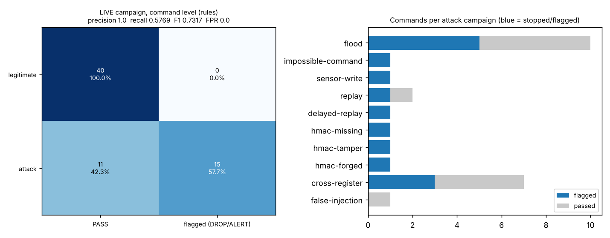
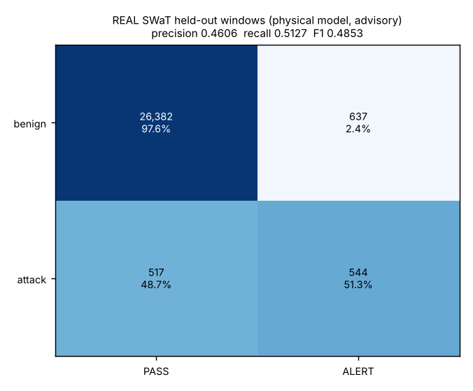

# Evidence pack

Generated by `python -m benchmark.evidence_pack`. Three kinds of evidence, **kept separate on purpose**: never quote one as if it were another.

| # | evidence | data | what it supports |
|---|---|---|---|
| 1 | Live campaign | real Modbus/TCP into the real middleware and PLC twin on loopback; labelled by phase | the deterministic rules stop the scripted attacks and leave legitimate traffic alone |
| 2 | Response layer | deterministic in-process demo | authorization policy, quarantine and incident correlation behave as designed |
| 3 | Held-out SWaT | REAL SWaT data, recorded from a local run | how well the advisory ML model flags real attack windows (honest, modest numbers) |

## 1. Live campaign (rules, command level)

LIVE campaign: real PLC twin + middleware + dashboard on loopback, real Modbus/TCP; rule layer (physical ML model cold)

Commands are labelled by the phase that sent them: legitimate phase = benign, attack phases = attack. A multi-step attack whose early steps look normal therefore shows misses at command level. The physical ML model was cold (120 s warm-up), so this measures the rules.

**Command-level confusion matrix** (flagged = DROP or ALERT): TN 40 / FP 0 / FN 11 / TP 15 - precision 1.0, recall 0.5769, F1 0.7317, accuracy 0.8333, false-positive rate 0.0.

**Attack campaigns detected: 9/10** (a campaign is detected when at least one of its commands was stopped). Of the campaigns that actually pass through the middleware: **9/9**. `false-injection` writes straight to the PLC, so no inline control can stop it (documented limit); it is listed so the pack is not selective.

| phase | commands | dropped | alerted | passed | first flag at | why it was stopped | note |
|---|---|---|---|---|---|---|---|
| legitimate operator traffic | 40 | 0 | 0 | 40 | n/a | - | in-bounds signed writes at 1.7/s, below the rate limit |
| flood | 10 | 5 | 0 | 5 | 6 | RATE_LIMIT_EXCEEDED x5 | the first 5 frames are within the 5/s limit by design; frames beyond it are dropped |
| impossible-command | 1 | 1 | 0 | 0 | 1 | OUT_OF_BOUNDS x1 |  |
| sensor-write | 1 | 1 | 0 | 0 | 1 | WRITE_TO_SENSOR_REGISTER x1 |  |
| replay | 2 | 1 | 0 | 1 | 2 | REPLAY_DETECTED x1 | the original frame is legitimate; only the repeat is the attack |
| delayed-replay | 1 | 1 | 0 | 0 | 1 | HMAC_EXPIRED x1 |  |
| hmac-missing | 1 | 1 | 0 | 0 | 1 | HMAC_MISSING x1 |  |
| hmac-tamper | 1 | 1 | 0 | 0 | 1 | HMAC_INVALID x1 |  |
| hmac-forged | 1 | 1 | 0 | 0 | 1 | HMAC_INVALID x1 |  |
| cross-register | 7 | 3 | 0 | 4 | 5 | CROSS_REGISTER_VIOLATION x3 | ramp: early steps are individually safe; the unsafe combined state is what is stopped |
| false-injection | 1 | 0 | 0 | 1 | n/a | - | BYPASSES the middleware (direct write to the PLC): cannot be stopped inline, only seen afterwards by the physical model/envelope (documented limit) |

Incidents the dashboard grouped from this run: 1 (all attacks came from one source address, so they correlate into one incident).

- `INC-0001` **critical** - 127.0.0.1: 15 event(s) in 65 s - Flood / Rate Limit, Impossible Command (Out of Bounds), Write To Sensor Register

Reading the table honestly: attacks that are slow and stay inside normal bounds (for example freeze or ramp style) are **not** stopped by rules; that is what the advisory physical model is for, and its real-data performance is section 3. The command-level recall above counts every command of an attack campaign as an attack, including the ones that are allowed by design (see the note column), so it understates how many HARMFUL commands were stopped.

## 2. Response layer

RESPONSE LAYER: deterministic in-process demonstration (constructed scenario, virtual clock)

- **Quarantine:** 40 forged commands from one source were sent; the source was quarantined after command **2**, 38 later commands were refused at the first check, and another source still worked: **True**.
- **Incident:** severity `critical` - 127.0.0.2: 40 event(s) in 12 s - Blocked While Quarantined, Tampered / Forged HMAC - source quarantined

| policy case | result | reason |
|---|---|---|
| listed register, in limit | PASS | OK |
| listed register, over its limit | DROP | UNAUTHORIZED_VALUE |
| unlisted register | DROP | UNAUTHORIZED_REGISTER |
| source with no role | DROP | UNAUTHORIZED_SOURCE |

## 3. Recorded results (measured elsewhere, read from the repo)

**Held-out REAL SWaT test block, physical model (advisory).** 28,080 windows, 1,061 attack windows.

TN 26,382 / FP 637 / FN 517 / TP 544 - precision 0.4606, recall 0.5127, F1 0.4853, balanced accuracy 0.7446, ROC-AUC 0.8362, 1.173 false-alarm episodes per benign hour. Plain accuracy 0.9589 is **not** the headline: an always-benign detector scores 0.9622.

test block was used for exactly two refits in the v2 experiment (baseline and selected) and was also seen by the shipped model's revised protocol: held-out, not a pristine blind test. Windows need a 120 s history, so the window set differs slightly from the v1 record

**Rule regression on constructed scenarios** (RULE-BASED checks on CONSTRUCTED scenarios (deterministic rules; NOT SWaT, NOT a learned model)): TP 4400 / FP 0 / FN 0 / TN 200. Deterministic rules are expected to score 100 % on the cases they were written for; this is a regression check, not detection performance against an unknown attacker.

## Limits to state out loud

- The live campaign uses the project's own scripted attacks; it shows the rules behave as designed, not how an unknown attacker would fare.
- SWaT has no network traffic: cyber-rule behaviour cannot be validated on it. The ML model's numbers are window-level on real physical data and are modest (F1 about 0.49).
- The held-out block was seen in earlier experiments (held-out, not a pristine blind test), and has only 10 attack segments, so confidence intervals are wide.
