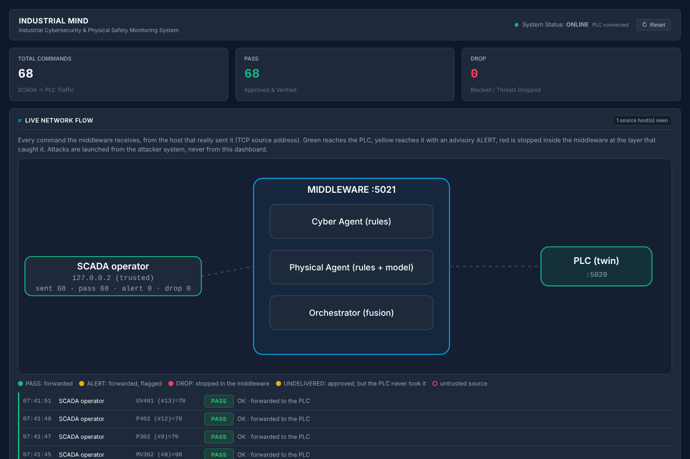
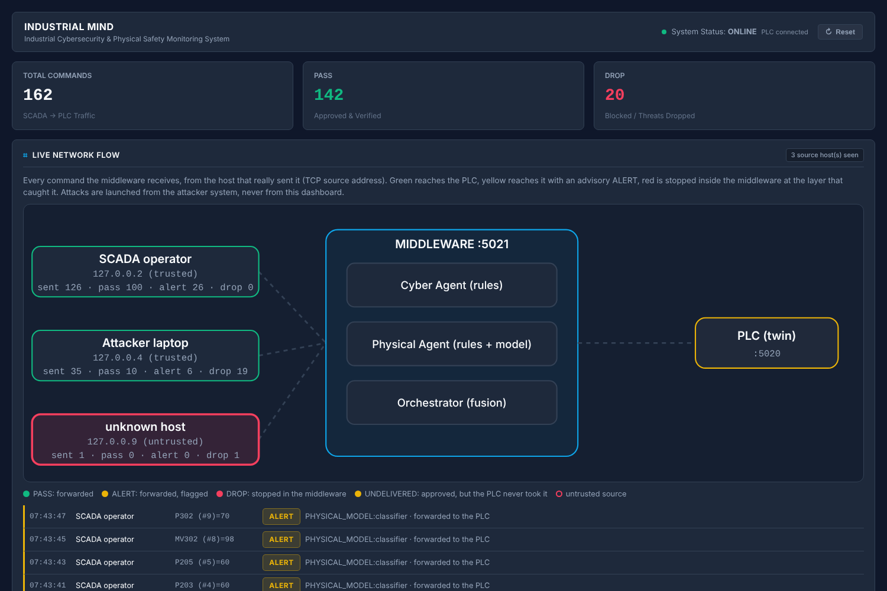
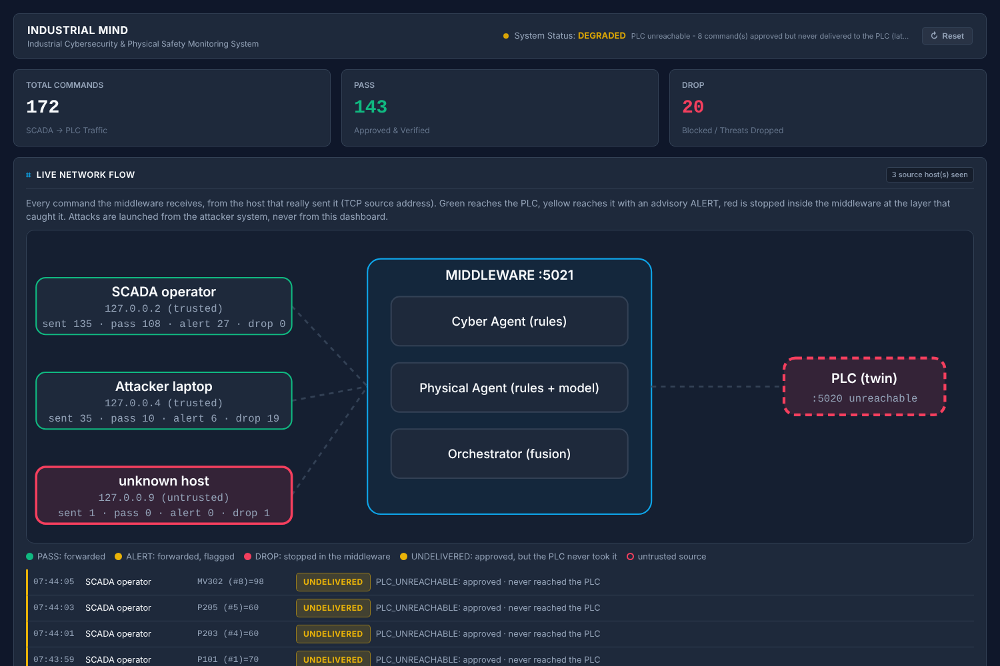
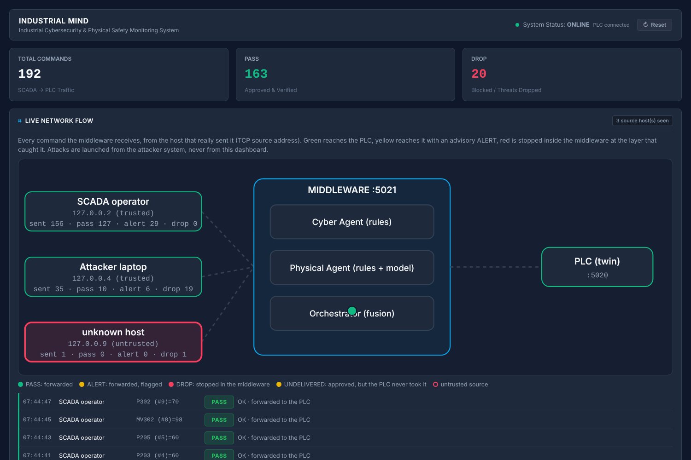
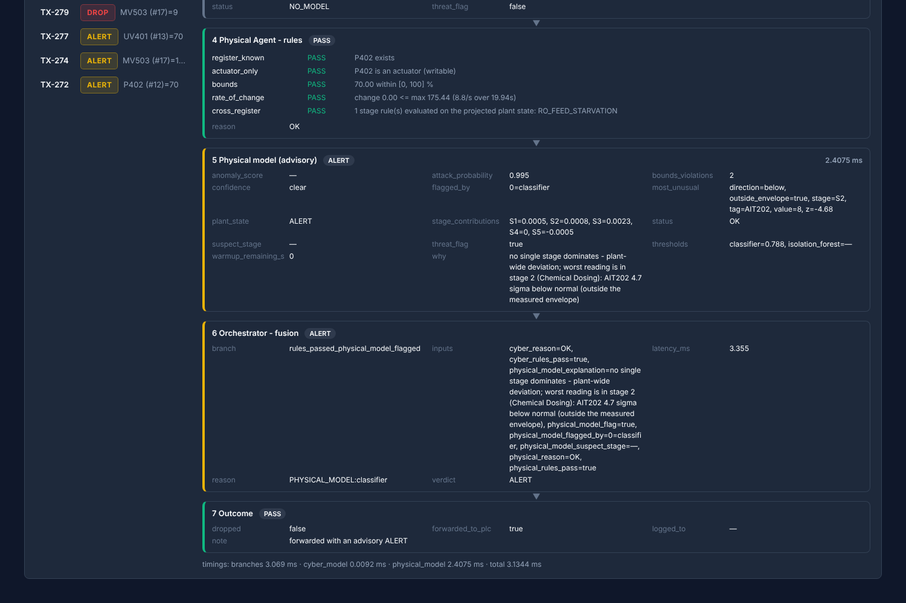

# Three-laptop end-to-end verification

**65/65 checks passed** in 326 s, on one machine, before the demo is run on three laptops. Generated by `python -m tools.verify_three_laptops` from that run's own result file; every row below is an observation, not an assertion by construction.

## What is real and what stands in

| | |
|---|---|
| **Real** | every process is started through the launcher scripts the laptops will use (`scripts/run.sh`), reading its addresses from a `lab.env`; the SCADA operator is the real `scada.scada` loop; the attacks are the real attacker CLI; real Modbus/TCP on real sockets; a real `tshark` capture of both legs; a real browser looked at the dashboard |
| **Stand-ins** | a loopback address per laptop (one host cannot have three NICs): Laptop 1 `127.0.0.1` middleware + dashboard, Laptop 2 `127.0.0.2` PLC **and** SCADA on one address, Laptop 3 `127.0.0.4` attacker, `127.0.0.9` a stranger |
| **One disclosed shim** | SCADA and the attacker must leave from *their* address, which a real laptop does by existing and one host must do by binding. A `sitecustomize` sets a source address on pymodbus clients for the single process that asks for it. It changes no behaviour of the system under test |
| **Not proven** | behaviour on real Wi-Fi, real firewalls, real NICs, macOS/Windows differences, or clock skew between machines. The preflight on each laptop is how those get caught |

## Results by stage

| Stage | Passed |
|---|---|
| 1. Start, in the documented order, through the launchers | 5/5 |
| 2. Preflight (the exact check each laptop will run) | 6/6 |
| 3. Normal operation: SCADA (Laptop 2) -> middleware (Laptop 1) -> PLC (Laptop 2) | 5/5 |
| 4. The attack campaign, from Laptop 3 (every attack launched through the launcher) | 22/22 |
| 5. Failure path: the PLC laptop goes away mid-demo, then comes back | 10/10 |
| 6. The dashboard process dies and restarts: the forensic record must survive (audit A4) | 8/8 |
| 7. The wire: a real capture of both legs, cross-checked against what the system says it did | 9/9 |

### 1. Start, in the documented order, through the launchers

| | Check | Observed |
|---|---|---|
| PASS | Laptop 2: PLC is listening on :5020 |  |
| PASS | Laptop 1: dashboard is up on :5050 |  |
| PASS | Laptop 1: middleware is listening on :5021 |  |
| PASS | the PLC says it accepts writes only from the middleware's address (S1), set by the LAUNCHER | ['  writes accepted only from: 127.0.0.1  (AUDIT S1; set IM_PLC_ALLOWED_WRITERS=any to disable)'] |
| PASS | the middleware loaded the live physical model (v2) |  |

### 2. Preflight (the exact check each laptop will run)

| | Check | Observed |
|---|---|---|
| PASS | preflight `check plc`: no problem except the loopback stand-in | 1 expected stand-in FAIL(s) (Laptop 1 is 127.0.0.1 here, which --multi rejects by design) |
| PASS | preflight `check middleware`: no problem except the loopback stand-in | clean |
| PASS | preflight `check dashboard`: no problem except the loopback stand-in | clean |
| PASS | preflight `check scada`: no problem except the loopback stand-in | 1 expected stand-in FAIL(s) (Laptop 1 is 127.0.0.1 here, which --multi rejects by design) |
| PASS | preflight `check attacker`: no problem except the loopback stand-in | 1 expected stand-in FAIL(s) (Laptop 1 is 127.0.0.1 here, which --multi rejects by design) |
| PASS | the HMAC secret fingerprint is identical on every signing laptop | {'middleware': 'b84420c4', 'scada': 'b84420c4', 'attacker': 'b84420c4'} |

### 3. Normal operation: SCADA (Laptop 2) -> middleware (Laptop 1) -> PLC (Laptop 2)

| | Check | Observed |
|---|---|---|
| PASS | SCADA's commands are seen by the middleware as coming from Laptop 2's address | 10 events |
| PASS | every SCADA command so far PASSED | 10/10 |
| PASS | and was forwarded to the PLC | 10/10 |
| PASS | /api/health says ok and reports the PLC as connected | ok / connected / [] |
| PASS | live plant telemetry is flowing to the dashboard |  |

### 4. The attack campaign, from Laptop 3 (every attack launched through the launcher)

| | Check | Observed |
|---|---|---|
| PASS | impossible-command: stopped as OUT_OF_BOUNDS | rc=0; 1 event(s); dropped for ['OUT_OF_BOUNDS'] |
| PASS | sensor-write: stopped as WRITE_TO_SENSOR_REGISTER | rc=0; 1 event(s); dropped for ['WRITE_TO_SENSOR_REGISTER'] |
| PASS | hmac-missing: stopped as HMAC_MISSING | rc=0; 1 event(s); dropped for ['HMAC_MISSING'] |
| PASS | hmac-tamper: stopped as HMAC_INVALID | rc=0; 1 event(s); dropped for ['HMAC_INVALID'] |
| PASS | hmac-forged: stopped as HMAC_INVALID | rc=0; 1 event(s); dropped for ['HMAC_INVALID'] |
| PASS | replay: stopped as REPLAY_DETECTED | rc=0; 2 event(s); dropped for ['REPLAY_DETECTED'] |
| PASS | replay: the first copy passed, only the identical copy was refused | [('PASS', 'OK'), ('DROP', 'REPLAY_DETECTED:no')] |
| PASS | delayed-replay: stopped as HMAC_EXPIRED | rc=0; 1 event(s); dropped for ['HMAC_EXPIRED'] |
| PASS | flood: stopped as RATE_LIMIT_EXCEEDED | rc=0; 10 event(s); dropped for ['RATE_LIMIT_EXCEEDED'] |
| PASS | flood: part of the burst passed, the rest was cut off (not everything blocked, not nothing) | 5 through, 5 dropped |
| PASS | cross-register: stopped as CROSS_REGISTER_VIOLATION | rc=0; 7 event(s); dropped for ['CROSS_REGISTER_VIOLATION'] |
| PASS | rogue host (not trusted): stopped as UNTRUSTED_SOURCE | rc=0; 1 event(s); dropped for ['UNTRUSTED_SOURCE'] |
| PASS | rogue host: stopped at the FIRST check (source whitelist) |  |
| PASS | false-injection (the bypass): the PLC REFUSED the attacker's direct write and logged its source | ['[PLC] REFUSED direct write from 127.0.0.4: MV101=0.00 - not an allowed writer (IM_PLC_ALLOWED_WRITERS=127.0.0.'] |
| PASS | ...and the plant was NOT driven to the attacker's value (MV101 is not 0) | MV101 before=22.0 after=23.0 |
| PASS | the legitimate half of false-injection went through the middleware like any signed command | ['ALERT'] |
| PASS | randomised slow-ramp attack (seed 7) runs to completion through the launcher | rc=0; 9 events: ['ALERT', 'DROP'] |
| PASS | THROUGHOUT the campaign no legitimate SCADA command was refused by an identity/auth/rate/replay rule (cyber layer) | 123 SCADA events seen, 0 cyber-layer drops |
| PASS | incident correlation grouped the attacker's events per source | 3 incident(s) for ['127.0.0.2', '127.0.0.4', '127.0.0.9'] |
| PASS | incidents are kept per source: the attacker's incident is separate from anything SCADA triggered | attacker INC-0001 (25 events); scada INC-0002 (23 events) |
| PASS | a SCADA-side incident (if any) contains only physical-rule events, never attack types like forged HMAC or replay | ['Advisory Model Alert'] |
| PASS | packet tracer: an HMAC_INVALID command shows the failing check and the rest NOT_RUN | [('source_whitelist', 'PASS'), ('function_code', 'PASS'), ('register_allowlist', 'PASS'), ('rate_limit', 'PASS'), ('hmac', 'FAIL'), ('replay', 'NOT_RUN'), ('quarantine',  |

### 5. Failure path: the PLC laptop goes away mid-demo, then comes back

| | Check | Observed |
|---|---|---|
| PASS | NETWORK FLOW view: with the PLC gone, SCADA's approved commands are UNDELIVERED, never a green PASS/ALERT | ['UNDELIVERED'] |
| PASS | EVENTS TABLE: the same commands read UNDELIVERED there too (the two views agree) | ['UNDELIVERED', 'UNDELIVERED', 'UNDELIVERED', 'UNDELIVERED', 'UNDELIVERED', 'UNDELIVERED', 'ALERT', 'ALERT'] |
| PASS | /api/health degrades and says the PLC is unreachable | degraded / unreachable / ['6 command(s) approved but never delivered to the PLC (latest 0s ago)', 'the middleware cannot reach the PLC (8 consecutive failed polls)'] |
| PASS | the dashboard header badge actually reads DEGRADED (a real browser looked) | 'DEGRADED' - 'PLC unreachable - 8 command(s) approved but never delivered to the PLC (latest 0s ago); the middleware cannot reach the PLC (9 consecutive failed polls)' |
| PASS | the log is not flooded by the outage (pymodbus lines are rate limited) | 4 lines |
| PASS | when the PLC returns, SCADA's commands are delivered again with no restart of anything else | ['PASS', 'PASS', 'PASS', 'PASS', 'PASS'] |
| PASS | /api/health reports the PLC as connected again | degraded / connected |
| PASS | LIVE: with the PLC back and no new undelivered command, health returns to ok on its own (no restart) | ok / connected / [] |
| PASS | ...while the record still counts what was lost | {'drop': 20, 'pass': 160, 'total_requests': 189, 'undelivered': 9} |
| PASS | LIVE: the header badge in a real browser is back to ONLINE, with the dashboard process never restarted | 'ONLINE' - 'PLC connected' |

### 6. The dashboard process dies and restarts: the forensic record must survive (audit A4)

| | Check | Observed |
|---|---|---|
| PASS | dashboard restarted |  |
| PASS | every incident survived the restart | 3 before, 3 after |
| PASS | the packet traces survived the restart | 192 before, 193 after |
| PASS | the UNDELIVERED corrections survived too (counted, not re-read as PASS) | {'drop': 13, 'pass': 79, 'total_requests': 101, 'undelivered': 9} |
| PASS | dashboard (normal): no failed requests | [] |
| PASS | dashboard (attack): no failed requests | [] |
| PASS | dashboard (degraded): no failed requests | [] |
| PASS | dashboard (recovered): no failed requests | [] |

### 7. The wire: a real capture of both legs, cross-checked against what the system says it did

| | Check | Observed |
|---|---|---|
| PASS | the capture holds Modbus traffic on BOTH legs (5021 and 5020) | 195 write frames to :5021, 167 to :5020 |
| PASS | every attacker write on the wire to the middleware was seen and judged by it (capture == dashboard) | 35 frames from 127.0.0.4, 35 decisions for it |
| PASS | the rogue host's frames were all seen and refused | 1 frames, 1 decisions |
| PASS | every write the PLC received from the middleware was one the middleware logged as FORWARDED (capture == log) | 166 frames on the PLC leg, 166 FORWARDED log lines |
| PASS | the ONLY hosts that wrote to the PLC are the middleware and the attacker's bypass attempt | ['127.0.0.1', '127.0.0.4'] |
| PASS | the attacker's frames on the PLC leg are exactly the one bypass attempt (dropped attacks never reached the PLC) | 1 frame(s) from 127.0.0.4 to :5020 |
| PASS | neither SCADA's address nor the rogue ever wrote to the PLC directly |  |
| PASS | the blocked-attack log has one record per DROP the middleware logged | 20 records, 20 DROP lines |
| PASS | no HMAC key or tag appears in the blocked-attack log |  |

## The wire, cross-checked

A real capture of both legs holds 195 write frames to the middleware (:5021) and 167 to the PLC (:5020).

| Two independent records of the same events | Count A | Count B |
|---|---|---|
| attacker writes on the wire to the middleware vs decisions the middleware made for that address | 35 | 35 |
| writes the PLC received from the middleware vs `FORWARDED` lines in the middleware log | 166 | 166 |
| `DROP` lines in the middleware log vs records in the blocked-attack log | 20 | 20 |

## What each attack did

| Attack | Decisions the middleware made |
|---|---|
| impossible-command | DROP OUT_OF_BOUNDS |
| sensor-write | DROP WRITE_TO_SENSOR_REGISTER |
| hmac-missing | DROP HMAC_MISSING |
| hmac-tamper | DROP HMAC_INVALID |
| hmac-forged | DROP HMAC_INVALID |
| replay | PASS OK, DROP REPLAY_DETECTED |
| delayed-replay | DROP HMAC_EXPIRED |
| flood | PASS OK, PASS OK, PASS OK, PASS OK, PASS OK, DROP RATE_LIMIT_EXCEEDED, DROP RATE_LIMIT_EXCEEDED, DROP RATE_LIMIT_EXCEEDED, DROP RATE_LIMIT_EXCEEDED, DROP RATE_LIMIT_EXCEEDED |
| cross-register | PASS OK, PASS OK, PASS OK, PASS OK, DROP CROSS_REGISTER_VIOLATION, DROP CROSS_REGISTER_VIOLATION, DROP CROSS_REGISTER_VIOLATION |
| rogue host (not trusted) | DROP UNTRUSTED_SOURCE |
| false-injection | ALERT PHYSICAL_MODEL |
| random ramp (seed 7) | ALERT PHYSICAL_MODEL, ALERT PHYSICAL_MODEL, ALERT PHYSICAL_MODEL, ALERT PHYSICAL_MODEL, ALERT PHYSICAL_MODEL, DROP CROSS_REGISTER_VIOLATION, DROP CROSS_REGISTER_VIOLATION, DROP CROSS_REGISTER_VIOLATIO |

## What the audience sees (screenshots from the real browser)

**Normal operation, after the model's 120 s warm-up**

**After the full attack campaign**

**The PLC laptop is down: header DEGRADED, PLC node red, commands UNDELIVERED**

**The PLC is back: header returns to ONLINE**

**The packet tracer at the bottom of the page**

